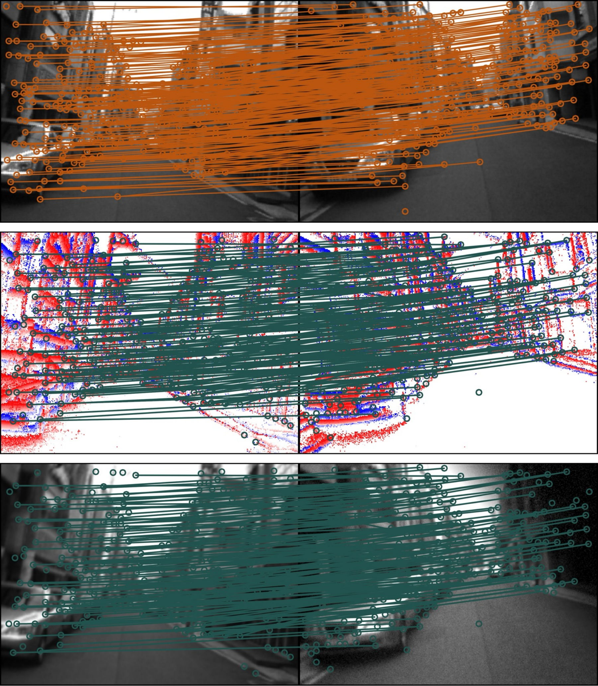
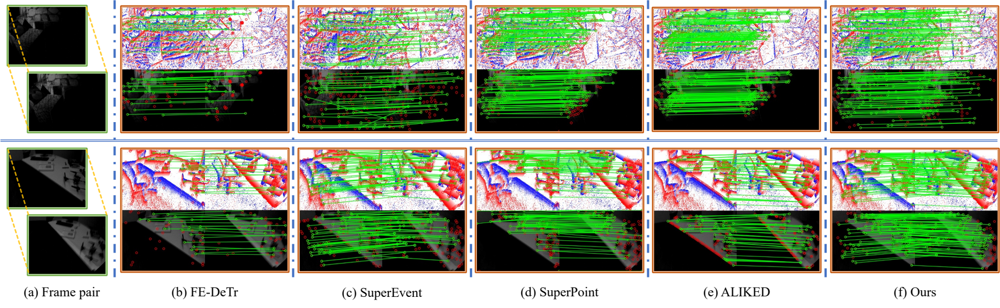
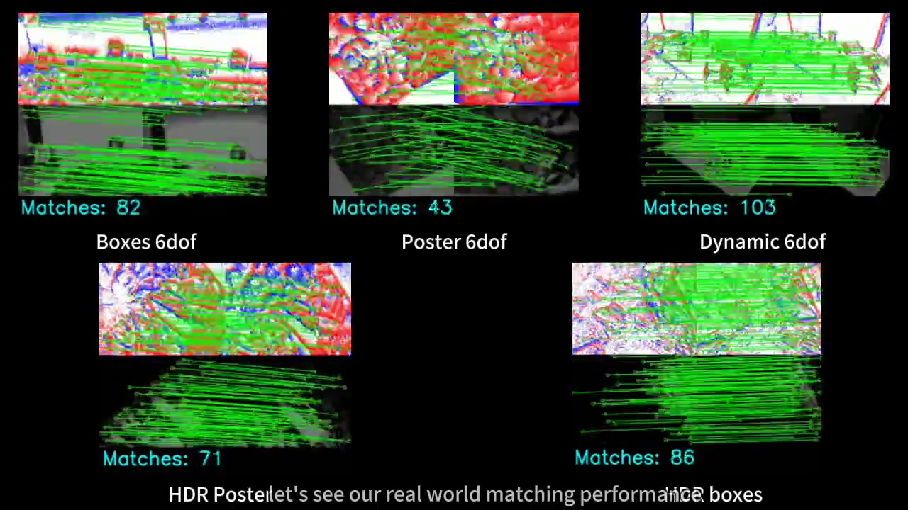

# FE-FusionPoints

English | [简体中文](README.zh-CN.md)

**Robust Keypoint Detection and Description through Gated Frame-Event Fusion**

<p align="center">
  
</p>

FE-FusionPoints detects and describes keypoints by fusing grayscale frames and 10-channel MCTS event representations through a Gated Injection Module (GIM) and Gated Cross-Attention Fusion (GCAF).

## Installation

Use Python 3.12 and PyTorch/torchvision matching your CUDA installation. Run all commands from the repository root.

```bash
python -m pip install -r requirements.txt
export PYTHONPATH="$PWD${PYTHONPATH:+:$PYTHONPATH}"
```

## Data preparation

Raw data → parallel CPU preprocessing → GPU pseudo-label generation → train/validation/test split. See [Data preparation](data_preparation/README.md) for input formats and commands.

## Training

Download the [MIT-licensed SuperPoint BN weights from rpautrat/SuperPoint](https://github.com/rpautrat/SuperPoint/blob/master/weights/superpoint_v6_from_tf.pth) to `pretrained/superpoint_v6_from_tf.pth` for initialization and the teacher model.

Stage 1 trains the event branch; Stage 2 trains the frame-event fusion model:

```bash
python train_fusion.py --config config/stage1.yaml \
  --data_root /path/to/SuperEvent_data --device cuda --output_dir /path/to/stage1

python train_fusion_deblur.py --config config/fe_fusionpoint.yaml \
  --data_root /path/to/SuperEvent_data \
  --event_ckpt /path/to/stage1/saved_models/stage1_event_YYYYMMDD-HHMMSS_final.pth \
  --device cuda --output_dir /path/to/stage2
```

Set `--event_ckpt` to the actual Stage 1 output. Final weights are named `<config>_<train_type>_<timestamp>_final.pth`; weights and TensorBoard logs are saved under `--output_dir`.

## Evaluation

The default configuration is `config/fe_fusionpoint.yaml`, with the main weights at `saved_models/fe_fusionpoint.pth`. To evaluate your own checkpoint, add `--model /path/to/stage2_final.pth`.

```bash
python evaluate_pose_estimation_pairs_multi.py /path/to/EC \
  --dataset_name ecd --config config/fe_fusionpoint.yaml \
  --device cuda --save_path /path/to/results/ecd

python evaluate_pose_estimation_pairs_multi.py /path/to/mvsec \
  --dataset_name mvsec --config config/fe_fusionpoint.yaml \
  --device cuda --save_path /path/to/results/mvsec
```

The default ECD sequences are boxes_6dof, poster_6dof, dynamic_6dof, hdr_boxes, and hdr_poster. MVSEC uses outdoor_night1/2/3. Evaluation filters frames to the ground-truth time range, uses the fixed pairs and calibration in `evaluation/`, and reports AUC@5°/10°/20°.

## Test-set results



ECD comparison, left to right: input frame pairs, FE-DeTr, SuperEvent, SuperPoint, ALIKED, and FE-FusionPoints.

[**▶ Watch the demo video**](assets/iros_2026_new_cr.mp4)

[](assets/iros_2026_new_cr.mp4)

## Acknowledgments and license

Copyright (c) 2026 Junkang Chen (陈骏康), for additions and modifications.

This project is based on [SuperEvent](https://github.com/ethz-mrl/SuperEvent), with modifications prepared on 2026-11-06. The code and included main weights are released under [GNU GPLv3](LICENSE), which permits commercial use, modification, and redistribution under its terms. See [THIRD_PARTY_LICENSES.txt](THIRD_PARTY_LICENSES.txt) for third-party notices.
