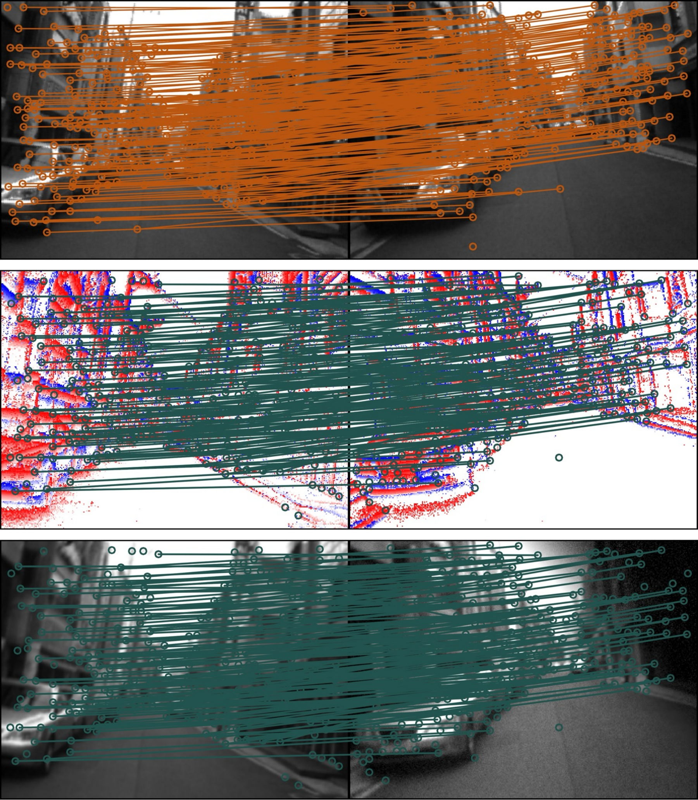
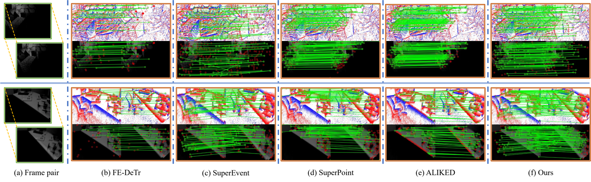
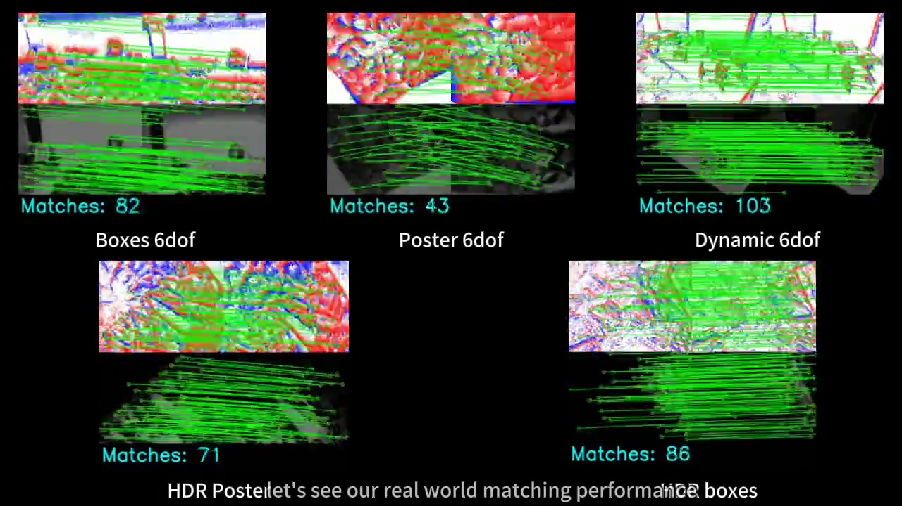

# FE-FusionPoints

[English](README.md) | 简体中文

**Robust Keypoint Detection and Description through Gated Frame-Event Fusion**

<p align="center">
  
</p>

通过 Gated Injection Module（GIM）和 Gated Cross-Attention Fusion（GCAF）融合灰度帧与 10 通道 MCTS 事件表示，输出关键点与描述子。

## 安装

使用 Python 3.12，安装与本机 CUDA 匹配的 PyTorch/torchvision，然后安装依赖。以下命令均在仓库根目录运行。

```bash
python -m pip install -r requirements.txt
export PYTHONPATH="$PWD${PYTHONPATH:+:$PYTHONPATH}"
```

## 数据准备

原始数据 → CPU 并行预处理 → GPU 伪标签 → 训练集、验证集和测试集划分。输入格式及命令见 [数据准备说明](data_preparation/README.zh-CN.md)。

## 训练

下载 [rpautrat/SuperPoint 提供的 MIT 版本 BN 权重](https://github.com/rpautrat/SuperPoint/blob/master/weights/superpoint_v6_from_tf.pth)，放到 `pretrained/superpoint_v6_from_tf.pth`，用于初始化和教师模型。

Stage 1 训练事件分支，Stage 2 训练帧事件融合模型：

```bash
python train_fusion.py --config config/stage1.yaml \
  --data_root /path/to/SuperEvent_data --device cuda --output_dir /path/to/stage1

python train_fusion_deblur.py --config config/fe_fusionpoint.yaml \
  --data_root /path/to/SuperEvent_data \
  --event_ckpt /path/to/stage1/saved_models/stage1_event_YYYYMMDD-HHMMSS_final.pth \
  --device cuda --output_dir /path/to/stage2
```

将 `--event_ckpt` 替换为第一阶段实际输出的权重路径。最终权重命名为 `<配置名>_<train_type>_<时间戳>_final.pth`；权重和 TensorBoard 日志保存到 `--output_dir`。

## 评测

默认使用 `config/fe_fusionpoint.yaml` 和主权重 `saved_models/fe_fusionpoint.pth`。评测自己的训练产物时，添加 `--model /path/to/stage2_final.pth`。

```bash
python evaluate_pose_estimation_pairs_multi.py /path/to/EC \
  --dataset_name ecd --config config/fe_fusionpoint.yaml \
  --device cuda --save_path /path/to/results/ecd

python evaluate_pose_estimation_pairs_multi.py /path/to/mvsec \
  --dataset_name mvsec --config config/fe_fusionpoint.yaml \
  --device cuda --save_path /path/to/results/mvsec
```

ECD 默认评测 boxes_6dof、poster_6dof、dynamic_6dof、hdr_boxes、hdr_poster；MVSEC 默认评测 outdoor_night1/2/3。脚本按 GT 时间筛选图像，使用 `evaluation/` 中的固定帧对和标定，计算 AUC@5°/10°/20°。

## 测试集效果展示



ECD 对比结果从左到右为：输入帧对、FE-DeTr、SuperEvent、SuperPoint、ALIKED 和 FE-FusionPoints。

[**▶ 观看效果演示视频**](assets/iros_2026_new_cr.mp4)

[](assets/iros_2026_new_cr.mp4)

## 来源与许可

Copyright (c) 2026 Junkang Chen（陈骏康），适用于本项目新增内容及修改。

本项目基于 [SuperEvent](https://github.com/ethz-mrl/SuperEvent) 修改，版本整理日期为 2026-11-06。代码及随附主权重采用 [GNU GPLv3](LICENSE)，允许商业使用、修改和再分发，须遵守 GPLv3 条款。第三方声明见 [THIRD_PARTY_LICENSES.txt](THIRD_PARTY_LICENSES.txt)。
